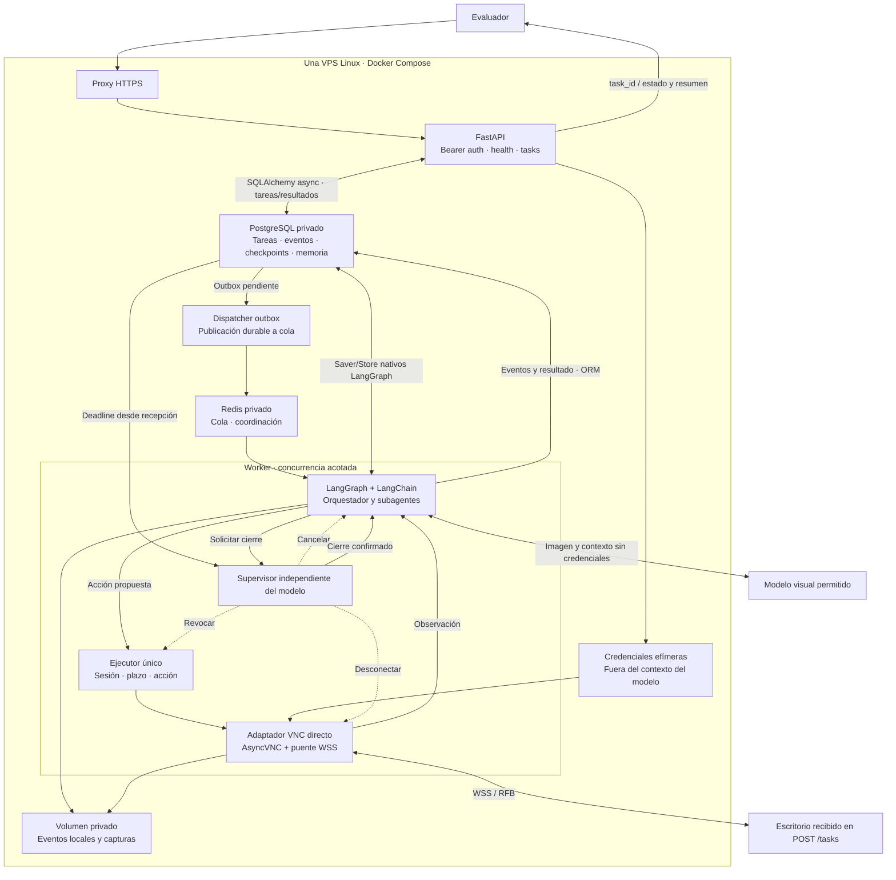

# Arquitectura del demo en VPS

Versión 0.3 · Diseño propuesto.

Despliegue previsto para la hackathon: una VPS, API y worker separados, Redis, PostgreSQL y volumen local. No requiere Chromium, Playwright, Kubernetes ni LangSmith. LangSmith permanece deshabilitado; sí se registran eventos locales sin secretos.

El transporte VNC directo está validado en el notebook; la API y el grafo todavía deben implementarse. Comenzar con capacidad medida y ampliar slots solo para escritorios independientes. La VPS es un punto único de fallo; el demo no promete alta disponibilidad.

[Fuente Mermaid](arquitectura-demo.mmd)

[Persistencia, memoria y trazabilidad](persistencia.md): PostgreSQL desde el demo; ORM para entidades y adaptadores nativos para LangGraph.
