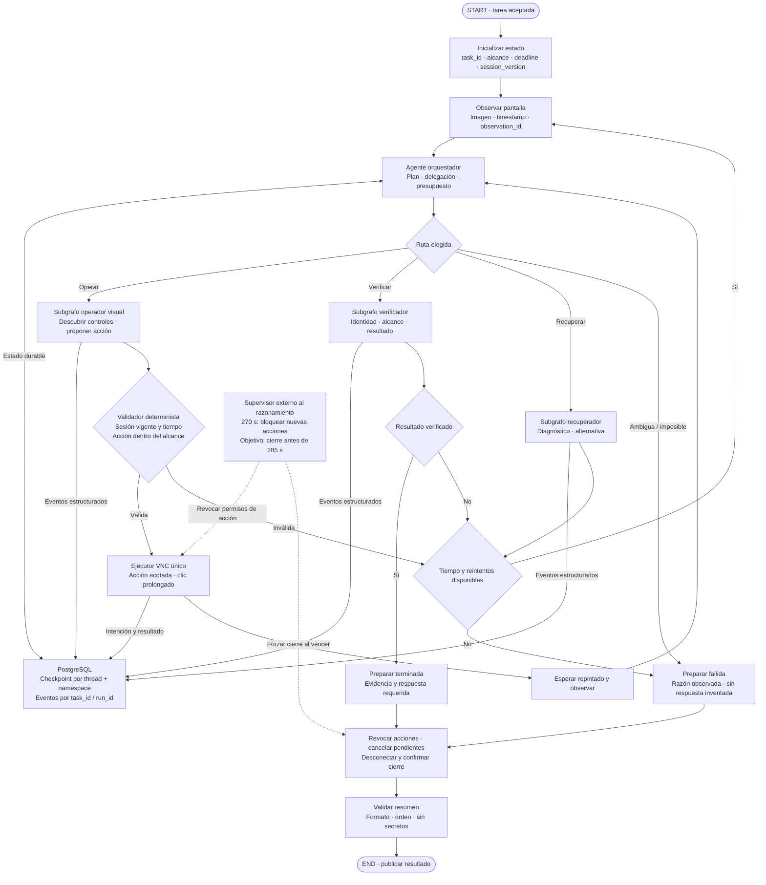

# Arquitectura multiagente

Versión 0.3 · Diseño propuesto.

Vista lógica del grafo y sus subgrafos, con nodos deterministas separados de los agentes. Se visualizará como recorrido de ejecución y árbol de llamadas en herramientas del ecosistema LangGraph/LangSmith; este diagrama no es una captura de una ejecución real.

El orquestador mantiene memoria por tarea y entrega contexto mínimo a cada especialista. Operador, verificador y recuperador devuelven resultados estructurados al orquestador. Solo el ejecutor tiene acceso al adaptador. Las llamadas a modelos no implican servidores separados por subagente.

Los especialistas se invocan por hitos. El paralelismo se limita a análisis independientes de la misma observación; toda propuesta se revalida contra la versión actual antes de ejecutar. La política del controlador es necesaria, pero no puede demostrar mecánicamente todos los efectos de un clic en una app desconocida.

[Fuente Mermaid](arquitectura-multiagente.mmd)

[Persistencia, memoria y trazabilidad](persistencia.md): PostgreSQL desde el demo; ORM para entidades y adaptadores nativos para LangGraph.
