# Arquitectura global de producción

Versión 0.3 · Diseño propuesto.

```mermaid
flowchart LR
    client["Cliente / Evaluador"]
    ingress["Entrada HTTPS / Balanceador"]
    subgraph control["Plano de control"]
        api["Réplicas FastAPI<br/>Auth · admisión · tasks · health"]
        db["PostgreSQL<br/>Tareas · eventos · checkpoints · memoria"]
        queue["Redis<br/>Cola · coordinación · límites"]
        dispatcher["Dispatcher outbox"]
        vault["Secretos de sesión<br/>Acceso restringido · TTL"]
    end
    subgraph execution["Plano de ejecución · escalable por escritorios"]
        scheduler["Scheduler<br/>Capacidad · deadline · cuotas"]
        workers["Pool de workers<br/>LangGraph + LangChain<br/>Orquestador y subagentes"]
        gateways["Pool de gateways VNC<br/>Ejecutor único por escritorio<br/>Lease + versión de sesión"]
        watchdog["Supervisor independiente<br/>Deadline · revocación · cierre"]
        storage["Almacenamiento privado<br/>Capturas · evidencias · retención"]
    end
    model["Modelo visual permitido<br/>Concurrencia y presupuesto"]
    desktops["Escritorios externos<br/>URL y contraseña por tarea"]
    sanitizer["Filtro de telemetría<br/>Sin secretos ni imágenes por defecto"]
    smith["LangSmith · producción<br/>Trazas · evaluación · latencia y coste"]
    metrics["Métricas de servicio<br/>Cola · leases · cancelación · disponibilidad"]
    client --> ingress --> api
    api -->|"Estado durable y resultado"| db
    db -->|"Outbox"| dispatcher -->|"Referencia de tarea"| queue
    api -->|"Credenciales fuera del grafo"| vault
    queue --> scheduler --> workers
    workers <-->|"Saver/Store y eventos por tarea"| db
    workers <-->|"Inferencia visual"| model
    workers <-->|"Propuestas y observaciones"| gateways
    vault --> gateways
    gateways <-->|"WSS / RFB · único canal"| desktops
    gateways --> storage
    scheduler --> watchdog
    watchdog -.->|"Cancelar ejecución"| workers
    watchdog -.->|"Revocar y desconectar"| gateways
    workers -->|"Resultado tras cierre confirmado"| db
    workers --> sanitizer --> smith
    gateways --> metrics
    queue --> metrics
    api -->|"task_id / estado y resumen"| client
    style control fill:#E3F2FD,stroke:#1976D2,color:#123B63
```

Arquitectura objetivo, no infraestructura ya implementada. Los workers no tienen acceso directo al escritorio: el gateway es el único emisor de entrada VNC. Una tarea pertenece a un tenant, un worker y una versión de sesión. Se escala por escritorios independientes, no multiplicando operadores sobre uno compartido.

LangSmith recibe telemetría filtrada; las capturas quedan en almacenamiento privado. PostgreSQL separa estado durable de la cola. El scheduler considera que el plazo empieza al recibir la petición, incluyendo espera. Ver [decisiones y escalabilidad](decisiones.md).

[Fuente Mermaid](arquitectura-produccion.mmd)

[Persistencia, memoria y trazabilidad](persistencia.md): PostgreSQL desde el demo; ORM para entidades y adaptadores nativos para LangGraph.
