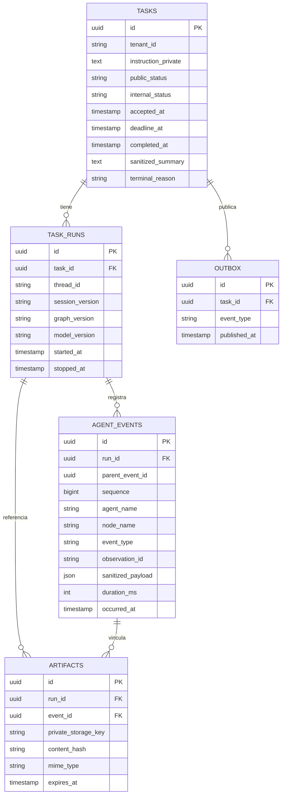

# Persistencia, memoria y trazabilidad

Versión 0.3. PostgreSQL se incorpora al demo y a producción. Diseño pendiente de implementación; el notebook VNC no usa todavía esta base.

## Tres responsabilidades en una misma instancia

| Responsabilidad | Acceso | Contenido |
|---|---|---|
| Datos de aplicación | SQLAlchemy 2 asíncrono + psycopg 3; migraciones Alembic | Tareas, ejecuciones, eventos, artefactos y outbox |
| Memoria de ejecución | `AsyncPostgresSaver` de LangGraph | Checkpoints del estado por `thread_id` y namespace de subgrafo |
| Memoria de largo plazo | `AsyncPostgresStore` de LangGraph | Conocimiento reutilizable explícito, aislado por tenant/app/versión |

Misma instancia PostgreSQL, tablas/esquemas y permisos diferenciados. El ORM administra nuestras entidades; no reimplementa las tablas de checkpoints ni las modifica con Alembic. Las estructuras nativas de LangGraph se inicializan mediante su mecanismo `setup` en un paso controlado de bootstrap, separado de las migraciones de la app.

Usar pools acotados independientes para ORM y adaptadores LangGraph. Una `AsyncSession` por unidad de trabajo; no compartirla entre subagentes concurrentes ni mantener transacciones abiertas durante una llamada al modelo o interacción VNC. Total de conexiones de todas las réplicas debe caber en el presupuesto de PostgreSQL.

## Modelo lógico de aplicación

Es un modelo propuesto; el DDL y nombres definitivos se fijan al implementar. `event_id` puede ser nulo para una evidencia del conjunto de ejecución. Los eventos pueden tener padre para reconstruir llamadas del orquestador a especialistas. Orden por `sequence` dentro de la ejecución, además del timestamp.

Índices previstos: tareas por `(tenant_id, accepted_at)` y `(internal_status, deadline_at)`; ejecuciones por `task_id`; eventos únicos por `(run_id, sequence)` y búsqueda por `(run_id, agent_name, occurred_at)`; outbox pendiente. Políticas de retención y exportación por tenant. Checkpoints administrados por LangGraph conservan sus propias estructuras e índices.

## Flujo durable de aceptación y ejecución

1. FastAPI autentica y registra `tasks` + mensaje `outbox` en una transacción corta. Solo devuelve `task_id` si el commit confirma persistencia, dentro de dos segundos.
2. Un dispatcher publica referencias de tarea desde outbox a Redis; no publica contraseñas ni imágenes. PostgreSQL es la fuente de verdad, Redis la cola/coordinación.
3. Worker reclama la ejecución mediante transición atómica y propiedad de sesión; mensajes duplicados no permiten dos operadores. La cola puede entregar más de una vez: no implica ejecutar dos veces los efectos externos.
4. Orquestador se ejecuta con `thread_id` relacionado con `task_id/run_id`. Checkpointer conserva progreso; eventos de aplicación conservan trazabilidad estructurada.
5. Antes de una acción mutante, registrar intención; después, resultado del transporte y comprobación visual. Una intención sin resultado es incierta y requiere observar, no repetir.
6. Tras cierre VNC confirmado, actualizar estado/resumen terminal y registrar evento. `GET /tasks/{id}` consulta PostgreSQL.

Outbox evita perder una tarea aceptada entre commit y publicación a Redis. Redis caído: dispatcher puede reintentar publicación dentro del plazo; nunca extenderlo. Todos los estados internos previos al cierre se proyectan a `en_curso`; públicos finales son solo `terminada` y `fallida`.

La aceptación depende de disponibilidad PostgreSQL; `/health` no debe indicar listo si DB/worker no están operativos. La persistencia no autoriza nuevas acciones cuando el plazo vence. Si no podemos registrar una intención mutante, no enviarla; cerrar de forma conservadora. Un resultado perdido después de guardar no permite asegurar que el efecto no ocurrió.

## Memoria de agentes

**Corto plazo:** `AsyncPostgresSaver`; un thread por ejecución de tarea, con namespaces de subgrafos. El orquestador mantiene plan, mensajes seleccionados y referencias a observaciones; especialistas reciben solo el contexto necesario. Reconstruir historial no exige leer todos los eventos ni toda la base en cada paso.

**Largo plazo:** `AsyncPostgresStore`; namespace por tenant/app/versión, para procedimientos genéricos validados y datos permitidos. No se convierte automáticamente cada interacción en memoria. En evaluación, deshabilitar reutilización de datos de negocio entre tareas/escritorios y no memorizar respuestas esperadas. Una receta de navegación aprendida se valida en la pantalla nueva.

Checkpoints no reemplazan la auditoría ni hacen idempotentes las acciones. Recuperación exige verificar plazo, sesión y pantalla; tras reset de evaluación no se reanuda. No hace falta pgvector ni embeddings para la primera entrega; búsqueda semántica queda como evolución si aporta valor medible.

## Qué se registra

- Delegación: agente, objetivo acotado, evento padre y resultado estructurado.
- Modelo: identificador/proveedor, versión, duración, uso/coste disponibles y salida validada.
- Tool: tipo, argumentos permitidos sanitizados, observación de origen y resultado.
- Verificación/recuperación: evidencia referenciada, conclusión y siguiente paso.
- Ciclo de vida: admisión, inicio, revocación, cierre y razón terminal.

No registrar razonamiento privado del modelo; usar decisiones estructuradas y explicaciones breves. No almacenar requests/responses completos por defecto. Credenciales VNC, tokens y URI de DB no entran en tablas de eventos, checkpoints ni contexto del modelo. La instrucción puede contener datos privados y requiere permisos/retención adecuados.

Imágenes: archivos privados en demo, almacenamiento de objetos privado en producción; DB guarda referencias/hash/metadatos. Inyectar imagen transitoriamente en la llamada visual y conservar solo referencias en estado persistido; evitar que mensajes con base64 se guarden automáticamente en checkpoints.

Eventos append-only por política de aplicación, sin prometer inmutabilidad criptográfica. Limitación de volumen por tarea y purga controlada, manteniendo datos requeridos para evaluación/debrief.

## LangSmith y fuente de verdad

Demo: consultar PostgreSQL para reconstruir interacciones; LangSmith sigue deshabilitado. Producción: trazas exportadas con `task_id`, `run_id`, agente y evento padre, sanitizadas antes de salir. PostgreSQL sigue siendo la fuente de verdad de tareas/resultados; LangSmith complementa análisis visual y evaluación. No exportar automáticamente todo el historial ni las imágenes.

## Pruebas de persistencia propuestas

- Reiniciar API y comprobar consulta de tarea/resultado.
- Interrumpir publicación tras commit y recuperar con outbox sin doble operador.
- Entregar dos veces un mensaje; comprobar una sola ejecución activa.
- Reconstruir delegación/acciones/verificaciones por tarea y orden de eventos.
- Cortar conexión tras guardar: observar antes de cualquier reintento.
- Reanudar checkpoint vencido: impedir toda entrada VNC.
- Comprobar aislamiento de threads/tenants y ausencia de secretos/base64 en tablas y trazas.
- Medir latencia de commit/aceptación y conexiones bajo carga.

## Fuentes

- [LangGraph: checkpointers y stores](https://docs.langchain.com/oss/python/langgraph/persistence).
- [Memoria PostgreSQL en LangGraph](https://docs.langchain.com/oss/python/langgraph/add-memory).
- [SQLAlchemy asíncrono y sesiones concurrentes](https://docs.sqlalchemy.org/en/20/orm/extensions/asyncio.html).

## Especificación de implementación

El modelo lógico anterior se concreta en [PostgreSQL](../02-ejecucion/specs/postgresql.md) y su [DDL de referencia](../02-ejecucion/specs/schema.sql), con sesiones, observaciones, acciones y credenciales cifradas además de las entidades iniciales. No es todavía una migración ejecutada.
