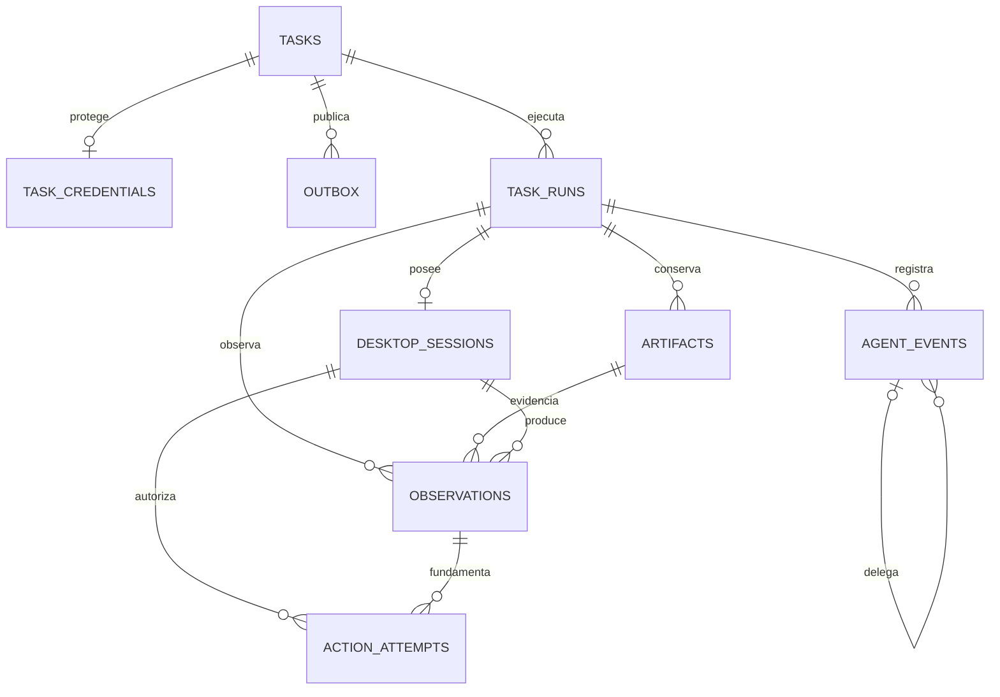

# Especificación PostgreSQL

Estado: estructura de referencia pendiente de migraciones. [schema.sql](schema.sql) define nombres, tipos, claves, índices y restricciones del MVP. PostgreSQL es la autoridad; Redis solo transporta referencias.

## Esquemas y permisos

| Esquema | Contenido | Gestión |
|---|---|---|
| app | 9 tablas propias: tasks, task_runs, desktop_sessions, agent_events, artifacts, observations, action_attempts, outbox, service_heartbeats | SQLAlchemy 2 async + Alembic |
| private | task_credentials, URL/password cifrados con AEAD, expiración y versión de clave | Alembic; lectura solo API de admisión y autoridad de sesión |
| graph_checkpoints | tablas nativas de AsyncPostgresSaver | setup nativo en bootstrap único |
| graph_store | tablas nativas de AsyncPostgresStore | setup nativo en bootstrap único |

Son **10 tablas propias en total**, 9 en app y 1 en private. No crear una tabla de clientes/facturas/pedidos: esas entidades pertenecen al escritorio y no tenemos API para sincronizarlas.

Credenciales: cifrar payload `{url,password}` usando biblioteca mantenida de cifrado autenticado (p. ej. Fernet); clave montada como secreto fuera de DB, no inventar criptografía. `destination_key` = HMAC-SHA256 de URL normalizada, con clave de configuración fuera de DB; permite exclusión sin almacenar URL en app. Retener secreto hasta cierre y eliminar; TTL límite accepted_at + 300 s. GC que expira credenciales también pide revocación de sesión, nunca conserva un socket activo por faltar contraseña. Tokens de equipo no se guardan en tablas: se validan contra configuración.

Roles: migrator con DDL; api con tasks/outbox y escritura private; worker con datos de aplicación y checkpoints/store, sin leer private; session authority con private y sesiones; dispatcher con outbox; supervisor con sesiones/tareas; rol auditor read-only sobre datos sanitizados. El MVP puede compartir proceso, pero no dar al modelo acceso SQL. Probar grants relevantes; secretos de cifrado y DB tampoco se inyectan en LangGraph.

Para nativos configurar search_path en conexión con esquema fijo, no entrada del usuario; verificar en integración que `setup()` crea allí las tablas. Si la versión fijada no lo soporta, usar DB dedicada para nativos y documentar ajuste. Alembic NO hace autogenerate sobre esos esquemas. Setup es una operación de bootstrap antes de readiness, no por petición/worker concurrente.

## Relaciones e invariantes

- task 1:N runs; máximo una run activa, incluyendo uncertain. Demo no reinicia automáticamente una run muerta para volver a clicar.
- run 1:1 sesión; máximo una sesión no cerrada por destination_key, incluso lease expirado.
- run 1:N eventos, artefactos, observaciones y acciones. FK compuestas impiden mezclar evidencias de otra run.
- evento padre pertenece a la misma run. La secuencia se asigna con UPDATE de contador en task_runs RETURNING, en la misma transacción que INSERT evento; no usar MAX()+1.
- observación fija epoch/frame_revision y referencia imagen privada. ActionProposal debe coincidir con esos valores en gate; SQL valida referencias, gate valida vigencia.
- task 1:1 credenciales; task 1:N outbox, unicidad de evento ready.
- status público se deriva; no mantener dos columnas que puedan divergir.
- Terminal requiere cierre de todas las sesiones de la task. No basta CHECK local: repositorio bloquea task y sesiones relevantes y verifica cierre; solo ese método puede finalizar. Añadir trigger de protección si múltiples escritores actualizan estado directamente. Prueba de carrera obligatoria.
- Terminal no cambia: CAS sobre status/version y guard de repositorio; repetir finalize devuelve mismo resultado, un resultado distinto se rechaza. No prometer que el DDL por sí solo impide toda transición inválida.

## Diagrama de entidades

`service_heartbeats` registra readiness por componente/instancia y no depende de una tarea. Checkpoints y store son estructuras nativas separadas; no introducir FK nuestras en sus tablas.

## Transacciones y cola

**Admisión:** calcular tiempos → cifrar secreto → INSERT tasks + private.task_credentials + outbox → COMMIT → responder. Si commit no se confirma, no responder task_id como aceptado. En timeout de red del cliente el commit puede haberse efectuado: registrar y no afirmar idempotencia de POST.

**Dispatcher:** reclamar un lote con `FOR UPDATE SKIP LOCKED`, marcar claimed_until, commit; publicar fuera de transacción con Redis Streams `XADD` usando task_id/outbox_id; marcar published_at. Caída entre publicación y marcado genera duplicado: permitido. Claim TTL vencido se recupera. No persistir payload de usuario en Redis.

**Consumer:** Redis consumer group entrega al menos una vez. Claim DB `UPDATE ... WHERE status='queued' RETURNING` + INSERT run en una transacción. Solo ganador ejecuta. Mensaje duplicado/terminal se ACK sin ejecutar. Mensajes pendientes se recuperan; ACK tras claim durable porque watchdog DB detecta run perdida. Crash antes del claim deja mensaje recuperable. Job perdido después del claim se cierra fallido conservadoramente, no replay del grafo.

**Reserva de sesión:** serializar por destination_key con advisory lock transaccional o fila de coordinación; comprobar ausencia de sesión abierta/uncertain, asignar epoch max+1 e insertar. Lock se mantiene solo durante reserva, no durante vida de socket. Índice parcial es segunda defensa. Lease es heartbeat y alarma, nunca permiso de takeover.

**Acción:** registrar intent y evento en transacción corta antes de emitir RFB; si falla persistencia no enviar. Después de envío guardar sent/result y observación/verificación. Un fallo entre envío y persistencia deja intent incierta: reconciliar observando, no reenviar. UUID de propuesta evita repetir el mismo envío lógico, pero no hace idempotente la app externa.

**Cierre:** autoridad revoca → confirma socket/proceso terminado → persiste sesión closed y run closed → task terminal y evento en transacción. Supervisor usa misma ruta. Secretos se purgan después de cierre. Caída DB no permite recuperar acciones; recuperar solo estado.

No mantener transacciones/AsyncSession a lo largo de awaits al modelo o VNC. Sesión ORM independiente por unidad de trabajo concurrente. Usar `postgresql+psycopg://` para SQLAlchemy y DSN psycopg para nativos; validar ambos desde config sin imprimirlos.

## Memoria y trazabilidad

thread_id = UUID de run; subgrafos tienen namespaces propios, no comparten mensajes indiscriminadamente. Saver persiste plan, hechos observados, decisiones tipadas, evidencia_ids y presupuestos. Estado excluye password, endpoint, token, base64 y razonamiento privado. Las imágenes se adjuntan fuera del estado checkpointed para la llamada visual.

Store de largo plazo inicializado, pero escritura/reutilización de datos de negocio deshabilitada en evaluación. Permitir solo procedimientos genéricos validados mediante política explícita, namespace por team/app/version; si app/version desconocida no reutilizar receta. La trazabilidad histórica vive en eventos, no convertir todo evento en memoria.

Cada llamada registra agente/nodo, parent, modelo/versión, duración, uso si disponible y decisión estructurada. Acciones registran intención, incertidumbre y evidencia; no guardar respuestas completas ni chain-of-thought. Eventos append-only durante retención; role runtime sin UPDATE/DELETE de eventos salvo tarea de purga autorizada. No se afirma inmutabilidad criptográfica.

## Retención y pools iniciales

Capturas/evidencias 24 h, checkpoints e instrucciones 7 días, eventos/resultados sanitizados 30 días; configurables y suspender purga de evidencia seleccionada hasta debrief. Imagen binaria en volumen privado; DB solo key/hash/metadatos. GC elimina objeto antes de marcar deleted_at, reintento idempotente. Purga de tareas respeta FK y borra tablas hijas/checkpoints/store apropiados; no usar borrado amplio por tenant sin control.

Presupuesto VPS inicial: API pool 5 + overflow 0, worker ORM 5, autoridad/supervisor/dispatcher 2 cada uno, saver 3 y store 2 = 21 conexiones máximas si esos pools son separados. Si se comparte pool, contar una vez. Validar contra max_connections con reserva para administración; no multiplicar por número de subagentes. Con réplicas Dokploy/Compose, calcular suma de pools por instancia: APIs × pool API + workers × pools worker/saver/store + autoridades/supervisores/dispatchers × sus pools. PostgreSQL sigue siendo una instancia en demo; replicar contenedores PostgreSQL sin replicación de datos no es una estrategia válida. Ver [despliegue](despliegue-dokploy.md).

## Migraciones y pruebas

M001 esquemas/tasks/secrets/outbox; M002 runs/sesiones/heartbeats; M003 eventos/artefactos/observaciones/acciones e índices. Grants/config de nativos son bootstrap aparte. Upgrade desde vacío y versión previa con datos; downgrade solo DB desechable; no ejecutar rollback destructivo en VPS con tareas reales. Comparar metadata ORM y DB en CI.

Pruebas DB obligatorias: transacción rollback admisión; doble claim y doble reserva; FK cross-run; secuencia concurrente; terminal antes de cierre rechazado; terminal inmutable; reconstrucción parent-child; expiry/purga; permisos private; aislamiento thread/store; restart y outbox duplicado. Ver IDs concretos en [plan de pruebas](pruebas.md).

## Contexto con procedencia y consejos — evolución v2

SharedTaskContext por run permanece en graph_checkpoints; mapas y hechos de evaluación no se comparten mediante graph_store. No crear una DB de clientes de la app remota. ContextPatch aceptado actualiza checkpoint con context_version/ui_generation y referencias a evidencias privadas. pending_operation sobrevive al restart y no autoriza replay.

AdviceRequest/Result son contexto privado del run, sin imagen ni secreto; persistir sólo campos validados y minimizados. agent_events registra request_id, role, source_version, observation_id, estado/latencia/modelo y relación padre, nunca contexto crudo. FinalDecision referencia evidencia y motivo breve en inglés. Retención/purga incluye estos registros; no añadir tablas/columnas sin una migración real y pruebas. La versión inicial de facts en strings sigue siendo baseline, no cumple todavía Fact con procedencia de v2.
